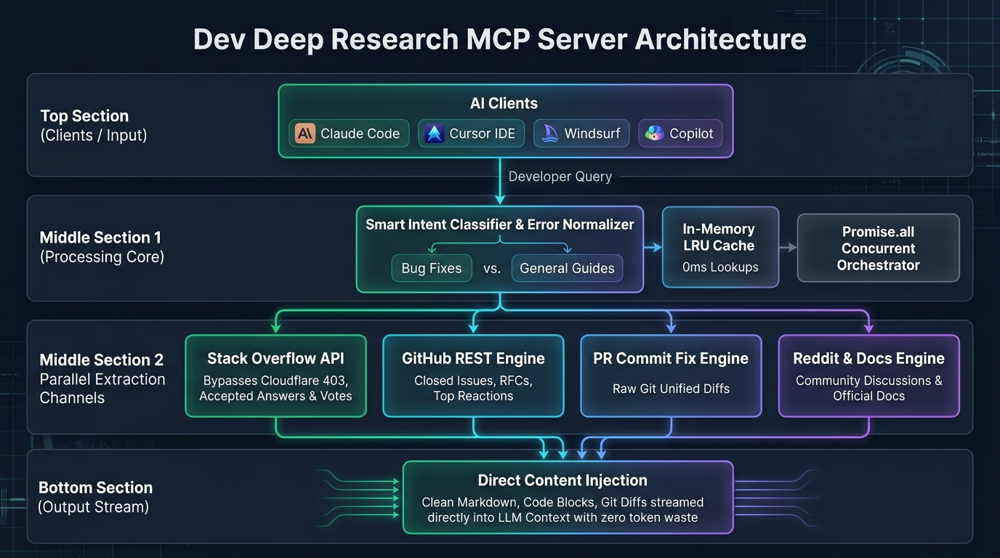

# Dev Deep Research MCP Server (`mcp-server-dev-research`)



A high-performance, 100% free Model Context Protocol (MCP) server designed specifically for developers and AI coding assistants. It executes deep research on coding bugs, compiler crashes, runtime exceptions, and dependency issues across **Stack Overflow**, **GitHub Closed Issues**, **Reddit dev communities**, and **technical documentation** simultaneously.

Unlike standard web searches that return superficial SEO links, this MCP server extracts **accepted answers, vote counts, maintainer resolutions, and raw code snippets directly into your AI assistant's context**.

---

## 🚀 Why This MCP is Better Than Built-in Search in Claude, Cursor, Windsurf & Copilot

Modern AI coding assistants (like **Claude Code / Desktop**, **Cursor IDE**, **Windsurf**, **GitHub Copilot Chat**, and **ChatGPT**) have built-in web search capabilities. However, when debugging code and library crashes, their standard search falls short. 

Here is why `dev-research` delivers dramatically superior results:

### 1. Claude (Claude Code / Desktop Web Search)
* **What Claude's Search Does:** Claude's native web search functions as a general search engine. It queries general search indexes and receives text summaries or raw snippets.
* **Why `dev-research` is Better:**
  * **Zero Cloudflare Blocks:** Claude often gets `403 Forbidden` or CAPTCHA-blocked when attempting to read Stack Overflow answers or Reddit threads directly. `dev-research` talks to the underlying **StackExchange REST API** and specialized mirrors, guaranteeing clean access.
  * **Verified Accepted Answers:** Standard search dumps entire question pages. `dev-research` isolates `is_accepted: true` answers and vote metrics, preventing Claude from recommending unverified or downvoted workarounds.

### 2. Cursor IDE & Windsurf (Built-in Web Scraping)
* **What Cursor & Windsurf Do:** When Cursor or Windsurf searches the web (`@web`), it extracts search result blurbs and occasionally fetches page DOMs.
* **Why `dev-research` is Better:**
  * **Actual Git Diffs via `find_commit_fix`:** Cursor cannot pull the exact lines of code maintainers committed to fix an issue. `dev-research` extracts the raw `git diff` (`+` and `-` changes) from merged PRs so the AI knows the exact patch syntax.
  * **Query Sanitization:** Cursor often sends your machine's full raw error log (including `C:\Users\YourName\...`, line numbers, and Webpack noise), which poisons general search queries and returns 0 results. `dev-research` automatically strips local path noise and bundler wrappers before searching.

### 3. GitHub Copilot
* **What Copilot Does:** Copilot searches public Bing results and official docs, but does not deeply cross-reference closed issues or developer discussions.
* **Why `dev-research` is Better:**
  * **Multi-Source Concurrency:** In one single turn, `dev-research` runs concurrent queries across **Stack Overflow + GitHub Issues + Merged PR Diffs + Reddit Discussions + Dev Docs**.
  * **Context Window Hygiene:** A normal web scrape floods the LLM with 20KB–50KB of cookie banners, sidebars, and ads, degrading context quality. `dev-research` delivers ultra-dense, pure Markdown code blocks.

---

### 📊 Feature-by-Feature Comparison

| Capability | Standard Search in AI (Claude / Cursor / Windsurf) | Dev Deep Research MCP |
| :--- | :--- | :--- |
| **Output Type** | SEO snippets and generic web links | **Verified code fixes, raw Git diffs, and step-by-step solutions** |
| **Context Hygiene** | Returns 50KB+ HTML with ads, cookies, and navbars | **Clean, LLM-optimized Markdown** isolating only the solution |
| **Verified Answers** | AI must guess which community answer works | Auto-detects `isAccepted: true` with vote scores via official APIs |
| **Merged PR Diffs** | ❌ Not available | **Extracts lines added (`+`) and removed (`-`) from merged fix PRs** |
| **GitHub Closed Issues** | Generic repo links or issue titles | Extracts **maintainer resolutions and top-reacted solution comments** |
| **Anti-Bot & Blocks** | Often blocked by Cloudflare (403) or CAPTCHAs | Bypasses blocks using official REST endpoints and low-overhead mirrors |
| **Error Sanitization** | Sends raw machine paths (`C:\Users\...`) that break queries | Auto-normalizes error traces, line numbers, and Webpack prefixes |
| **Speed & Token Savings** | High latency & token waste | **In-memory LRU caching** with near 0ms lookups on repeated errors |

---

## 🛠️ Features

* **Multi-Source Parallel Execution:** Automatically queries Stack Overflow, GitHub closed issues, Reddit developer discussions, and tech documentation concurrently with full `Promise.all` parallelism for ultra-fast response times (up to 7x faster than sequential scrapers).
* **Stack Overflow API Engine:** Uses StackExchange REST endpoints to isolate accepted answers and high-vote solutions concurrently without Cloudflare blocks.
* **GitHub Issues & Discussions:** Queries closed issues and extracts reaction counts, maintainer resolutions, and solution comments in parallel.
* **Merged PR Diff Engine:** Fetches unified Git diffs (`+` and `-`) for merged pull requests concurrently.
* **Reddit Thread Extractor:** Bypasses bot gates using lightweight endpoints to extract real developer workarounds and community fixes.
* **Error Sanitizer & Normalizer:** Automatically strips local file paths (e.g. `C:\Users\...` or `/var/log/...`), line numbers (`:42:15`), internal trace noise, and Webpack/Vite module prefixes (`(0, module.func)`) before querying.
* **Direct Thread Extractor (`fetch_thread_solution`):** Pass any Stack Overflow or GitHub issue URL to retrieve clean, formatted Markdown of the accepted answers and code blocks without ads or fluff, fetching question and answers simultaneously.
* **In-Memory LRU Cache:** 15-minute rolling cache prevents redundant network round-trips for repeated errors.

---

## 📦 Tools Provided

### 1. `deep_research_coding_issue`
Performs multi-source deep research on an error message or technical question.

**Inputs:**
* `query` *(string, required)*: The exact error code, bug message, or technical problem.
* `framework_or_language` *(string, optional)*: E.g., `react`, `docker`, `mongodb`, `next.js`, `python`, `node`.
* `sources` *(array, optional)*: `['stackoverflow', 'github', 'reddit', 'web']` (defaults to all).
* `max_results_per_source` *(number, optional)*: 1–5 results per source (default: 3).

### 2. `fetch_thread_solution`
Extracts only the accepted answers, discussion resolutions, and code blocks from a target URL.

**Inputs:**
* `url` *(string, required)*: The URL of the Stack Overflow question, GitHub issue, or documentation page.

### 3. `find_commit_fix`
Searches merged GitHub pull requests and commits that solved a specific bug or technical problem, extracting the **actual Git diff (lines added `+` and removed `-`)**.

**Inputs:**
* `query` *(string, required)*: The bug, error code, or function failure (e.g. `"useActionState is not a function"`, `"SIGKILL 137"`).
* `repository` *(string, optional)*: Scope search to a specific GitHub repository (e.g. `"vercel/next.js"`, `"facebook/react"`).
* `max_results` *(number, optional)*: Number of merged PR fixes to retrieve (default: 3, max: 5).

---

## ⚙️ Installation & Configuration

### 1. Clone & Install Dependencies

```bash
git clone https://github.com/Md-Romaan/mcp-server-dev-research.git
cd mcp-server-dev-research
npm install
```

### 2. Add to your MCP Config (`mcp_config.json` or Claude Desktop / Antigravity Config)

```json
{
  "mcpServers": {
    "dev-research": {
      "command": "node",
      "args": [
        "path/to/mcp-server-dev-research/index.mjs"
      ],
      "env": {
        "GITHUB_PERSONAL_ACCESS_TOKEN": "optional_token_for_higher_github_rate_limits"
      }
    }
  }
}
```

---

## 🔍 Common Search Queries & Example Scenarios

This MCP server is engineered to resolve high-frequency developer debugging scenarios that standard LLM search engines fail on:

| Scenario / Error Category | Example Queries | What Dev Research Solves |
| :--- | :--- | :--- |
| **React / Next.js Hydration** | `Error: Hydration failed because the initial UI does not match that which was rendered on the server` | Pulls verified server vs client suppression patterns from closed issues. |
| **Runtime Invariant Errors** | `Objects are not valid as a React child (found: object with keys {id, name})` | Extracts accepted Stack Overflow solutions with exact `.map()` object destructuring code. |
| **Breaking API Changes** | `TypeError: useActionState is not a function in React 19` | Locates merged PRs with the exact function rename and migration diffs. |
| **Container & OOM Kills** | `Command failed with exit code 137 (out of memory / SIGKILL)` | Finds high-vote Docker/Kubernetes memory allocation configurations. |
| **Node.js Module Resolution** | `ERR_REQUIRE_ESM: Must use import to load ES Module` | Delivers exact `package.json` `"type": "module"` and interop configurations without spam. |

---

## ⚡ Setup for Popular AI Coding Assistants

### Cursor IDE
1. Open Cursor Settings -> **Features** -> **MCP Servers**.
2. Click **Add New MCP Server**.
3. Name: `dev-research`, Type: `command`, Command: `node /absolute/path/to/mcp-server-dev-research/index.mjs`.

### Claude Code (CLI)
Add the server using the Claude CLI:
```bash
claude mcp add dev-research node /absolute/path/to/mcp-server-dev-research/index.mjs
```

### Claude Desktop
Edit your `claude_desktop_config.json`:
```json
{
  "mcpServers": {
    "dev-research": {
      "command": "node",
      "args": ["C:/absolute/path/to/mcp-server-dev-research/index.mjs"]
    }
  }
}
```

### Windsurf
Add to your `~/.codeium/windsurf/mcp_config.json` under `mcpServers`.

---

## 📄 License

MIT

